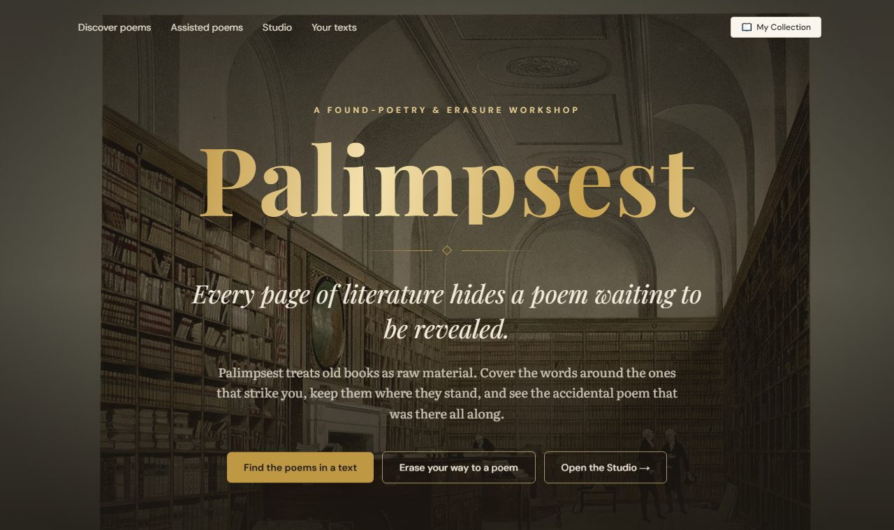

# Palimpsest

*A found-poetry and erasure workshop.* Open a page of an old book, cover the words around the ones that strike you,
keep the rest where they stand, and see the poem that was hiding there all along.

**Live site: <https://palimpsest-inky.vercel.app>**



## What you can do

- **Discover poems.** The app searches a page for lines that already scan as poetry (5–7–5 syllables, taken word for
  word from the text) and lets you pick one.
- **Assisted poems.** Take a poem one word at a time: the workshop offers words to keep while the rest of the page
  fades, and you decide where it ends.
- **The Studio.** Erase your way to a poem by hand: blackout, faded ink or whiteout, with undo, line breaks and notes.
- **Your own texts.** Add a `.txt` or `.docx` file or paste text, correct it, and use it like any book. Signed out, it
  stays in your browser; signed in, it is kept in your account and follows you to any browser.
- **The library.** Books from Project Gutenberg, searched by title or author, plus a "Surprise me" button.
- **My Collection.** Save poems, rename, duplicate or delete them, open them again, export them as a picture (PNG) or as
  text. With an account they are kept on the server.

## Built with

| What | Used |
|---|---|
| App | [Next.js](https://nextjs.org) 16 (App Router), React 19, TypeScript |
| Styling | Tailwind CSS 4; fonts Playfair Display, Literata and DM Sans |
| Database | **[Supabase](https://supabase.com) Postgres** (free plan), reached through the `pg` driver |
| Sign-in | **Supabase Auth**, with Google sign-in (an email one-time code is supported too) |
| Hosting | **[Vercel](https://vercel.com)** (Hobby plan); a daily call to `/api/health` keeps the free Supabase project awake |
| Syllable counts | [CMUdict](https://github.com/cmusphinx/cmudict), turned into a lookup table by `scripts/preprocess-cmudict.mjs` |
| Books | [Project Gutenberg](https://www.gutenberg.org), imported by hand (see "Adding books") |
| Picture export | `html-to-image` |
| Tests | Vitest, Testing Library, Playwright, and PGlite (Postgres running inside the tests) |

## How it fits together

```
screens (app/, components/)
   └── services (PoemService, BookService)         lib/services
          └── repositories                          lib/repositories
                 ├── in the browser: localStorage   poems and your own texts when signed out
                 └── on the server: /api/…          poems and texts for signed-in readers, and the library of books
                        └── Postgres (Supabase)     lib/server, db/schema.sql
```

`lib/services/container.ts` is the one place that chooses where data lives. With `NEXT_PUBLIC_DATA_BACKEND=browser`
(the default) there are no accounts and everything is kept in the browser. With `server`, signed-in readers' poems and
texts are stored in Postgres through the app's own API, and the library of books is read from the database.

## Run it on your computer

You need Node.js 22.12 or newer.

```bash
npm install
npm run dev          # http://localhost:3000, no accounts: poems are kept in your browser
```

To try the version with accounts and a database, with no keys and no setup:

```bash
npm run dev:demo     # http://localhost:3200
```

The "server" and its database are part of that one process. Sign in with **any email address and the code `123456`**.
It starts empty and forgets everything when stopped. It has a small library of three books.

## Put it online (Supabase and Vercel)

Both have free plans. It takes about an hour the first time. You make the accounts and keep the keys in the settings
pages named below, never in a file you commit (`.env*` files are ignored by git; `.env.example` lists every setting).

1. **Supabase: make the database.** Create a project. In **SQL Editor**, run the whole of `db/schema.sql`, then the whole
   of `db/supabase.sql` (both are safe to run again). Run them again whenever a new version of the app adds a table.
2. **Supabase: collect the settings.**
   - **Connect → Transaction pooler**: the connection string, with your database password in it and `?sslmode=require`
     on the end. This is `DATABASE_URL`.
   - **Project Settings → API**: the Project URL, the publishable key (`sb_publishable_…`) and the secret key
     (`sb_secret_…`, only used to delete accounts, and never to be shared).
3. **Google sign-in** (needs no email service). In Google Cloud Console, make a project, set up the **OAuth consent
   screen** (External, then publish it so anyone can sign in), and create an **OAuth client ID** of type *Web
   application* with your site's address as an authorised JavaScript origin and Supabase's callback address as a
   redirect URI. In **Supabase → Authentication → Providers → Google**, switch Google on and enter the client ID and
   secret. The site's privacy page is `/privacy`.
4. **Vercel: import the repository** (Add New → Project). Before the first deploy, add these under **Settings →
   Environment Variables** (Production):

   | Name | Value |
   |---|---|
   | `NEXT_PUBLIC_DATA_BACKEND` | `server` |
   | `NEXT_PUBLIC_SUPABASE_URL` | the Project URL |
   | `NEXT_PUBLIC_SUPABASE_PUBLISHABLE_KEY` | the publishable key |
   | `NEXT_PUBLIC_GOOGLE_CLIENT_ID` | the Google client ID |
   | `NEXT_PUBLIC_EMAIL_SIGN_IN` | `off` for Google-only sign-in; leave it out to offer an email code too |
   | `DATABASE_URL` | the connection string from step 2 |
   | `SUPABASE_URL` | the Project URL |
   | `SUPABASE_PUBLISHABLE_KEY` | the publishable key |
   | `SUPABASE_SECRET_KEY` | the secret key (mark it as a secret) |

   The `NEXT_PUBLIC_` settings are put into the page **when it is built**, so changing one needs a new deployment. In
   **Settings → Functions**, pick the region closest to your Supabase project.
5. **Check `/api/health`.** It needs no sign-in and should answer
   `{"ok": true, "settings": "ok", "database": "ok", "signIn": "ok", "accountDeletion": "ready", "rateLimiting": "ok", "library": "ok", "texts": "ok"}`.
   Anything else names what is missing (for example a table to create by running `db/schema.sql` again).
6. **Optional, recommended: a firewall rule** (the app cannot make it). **Project → Firewall → New Rule**: request
   path *starts with* `/api/`, **Rate Limit**, fixed window 60 seconds, 120 requests, key *IP*. The library's endpoints
   are public, so this is what limits them. Signed-in users are limited inside the app as well.

**Free-plan notes.** Supabase pauses a free project after about a week without activity. `vercel.json` has Vercel call
`/api/health` once a day to prevent that (check **Settings → Cron Jobs** in Vercel). Vercel's Hobby plan is for
non-commercial use. The free Supabase plan is not a backup service: export your data now and then.

## Adding books to the library

The library holds public-domain books (first published in 1930 or earlier) from Project Gutenberg, cut into excerpts
of about 450 words that end at a paragraph. The import never downloads anything: Gutenberg asks that automated
downloading be avoided, so you save the plain-text files yourself.

1. Choose a list of books: `data/library/pilot.json` is a ready ten-book example (Gutenberg numbers, titles, authors,
   years, and whether a book is prose or verse).
2. For each, save its **Plain Text UTF-8** file from `https://www.gutenberg.org/ebooks/<number>` as
   `data/library/raw/pg<number>.txt` (this folder is ignored by git).
3. Check what would happen (this needs no database), then import (this needs `DATABASE_URL`, for example in `.env.local`):

   ```bash
   npm run import:library -- --list data/library/pilot.json --dry-run
   npm run import:library -- --list data/library/pilot.json
   ```

The import checks that each file is really that book, removes Gutenberg's header and licence, finds the chapters, and
adds the book and its excerpts to the database, all or none. A book already there is left exactly as it is, because saved
poems point at the words of an excerpt by position; an excerpt must never be changed after people have used it.

## Tests

```bash
npm test                    # unit tests (Vitest)
npm run lint                # ESLint
npx tsc --noEmit            # types
npm run test:e2e            # browser tests (Playwright) on a production build, on port 3100
npm run test:e2e:server     # the same app with accounts and the server API, on a real SQL database in the test process
npm run test:e2e:demo       # the local demo with accounts
```

The first time, download the browsers with `npx playwright install chromium` (add `firefox webkit` to run all three).
The server and demo suites are run in Chromium only.

## Credits

- Books: [Project Gutenberg](https://www.gutenberg.org), public domain.
- Syllable counts: [CMUdict](https://github.com/cmusphinx/cmudict), Carnegie Mellon University (its licence is in
  `data/cmudict/LICENSE.txt`).
- Pictures, all public domain, from Wikimedia Commons: the library hall by Pyne (1819), *The Raven* by Gustave Doré
  (1884), William Blake's *Songs of Innocence* frontispiece, and an engraving of a chained book. The credits are also
  in the footer of the home page.
